

# ♞ Chess Mangrove

**A home for a team chess league: live matches, standings, predictions, fantasy, and training that learns from your own games.**

### [▶ Open the live site](https://chess-mangrove-sports.vercel.app) &nbsp;·&nbsp; [📱 Get the Android app](https://github.com/Stravix86/chess-mangrove-showcase/releases/latest/download/ChessMangrove.apk)

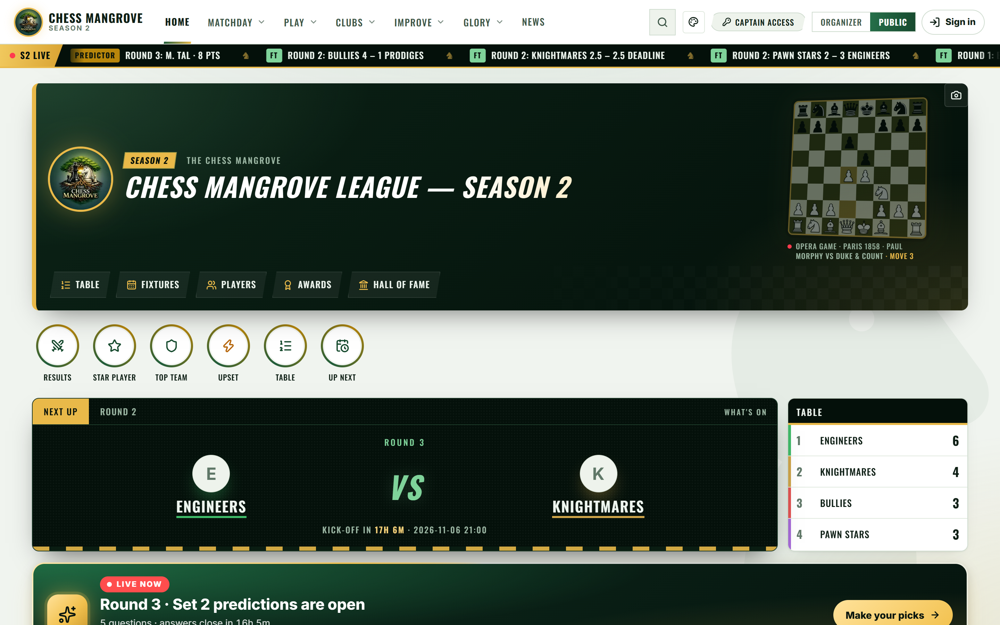

---

## 📱 Android app

**[Download ChessMangrove.apk](https://github.com/Stravix86/chess-mangrove-showcase/releases/latest/download/ChessMangrove.apk)** (under 1 MB) · [all versions](https://github.com/Stravix86/chess-mangrove-showcase/releases)

1. Open the link on your Android phone or tablet and download the file.
2. Open it. If your phone asks, allow your browser to install apps, then tap **Install**.
3. Chess Mangrove appears on your home screen.

- Works on **Android 5.0 and newer**, phones and tablets of any size, in portrait or landscape.
- Opens full-screen with its own icon and splash screen, and runs on the phone's own Chrome engine. Phones without a compatible browser use a built-in web view instead.
- **Updates itself:** the app always shows the latest site, so league news and new features arrive on their own. When a new version of the app itself is published, it shows an **Update** banner. You can also check any time from the account button → **Check for app updates**. Install the new file over the old one; your sign-in and progress stay.

---

## What it does

Chess Mangrove runs a team league played online on Lichess. Teams meet in rounds of board-vs-board matches, and the site handles everything around those games: fixtures, results, standings, a live view on match night, awards, and season records. It also gives fans and players reasons to come back every week.

### 🏆 The league
- **Live match night**: every board updates as it's played, with your own team and board shown first when you're signed in.
- **Standings, fixtures, results**: the table, form, upsets and playoffs, all worked out from real results.
- **Season stats and records**: fastest checkmate, longest game, biggest upset, longest winning run.
- **Awards and Hall of Fame** for each season.

### 🎯 For fans
- **Predictions**: guess what happens each round (results, any draws, who gains the most rating) and climb the table.
- **Fantasy**: pick four league players within a rating budget, choose a captain, and score from their real games.
- **One account everywhere**: sign in with Lichess (players) or Google (fans), follow a team, and get a personal "My matchday" card.

### 📈 For players
- **Learn from masters**: finds the opening mistakes you keep repeating in your own games. It then shows how grandmasters (and 2.2 million master games) handled the same move order, side by side on two boards.
- **Puzzles**: built from real winning chances that were missed in league games.
- **Opponent prep**: a scouting report on your next opponent's openings, recent form and habits.
- **Practice bots** with different playing styles.

Explanations never make anything up: they come from real game counts, Stockfish, or cited sources, and say so when nothing reliable is available.

## Screenshots

<table>
<tr>
<td align="center">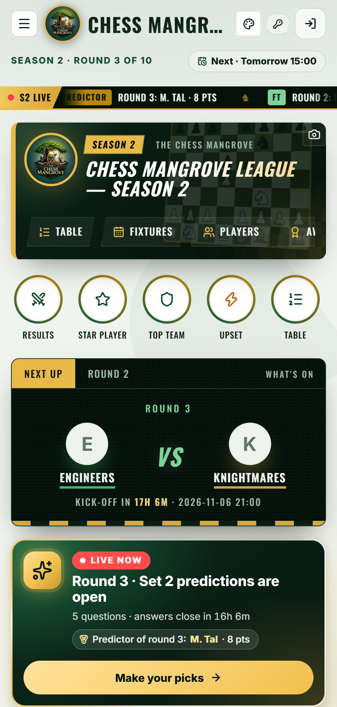 Home</td>
<td align="center">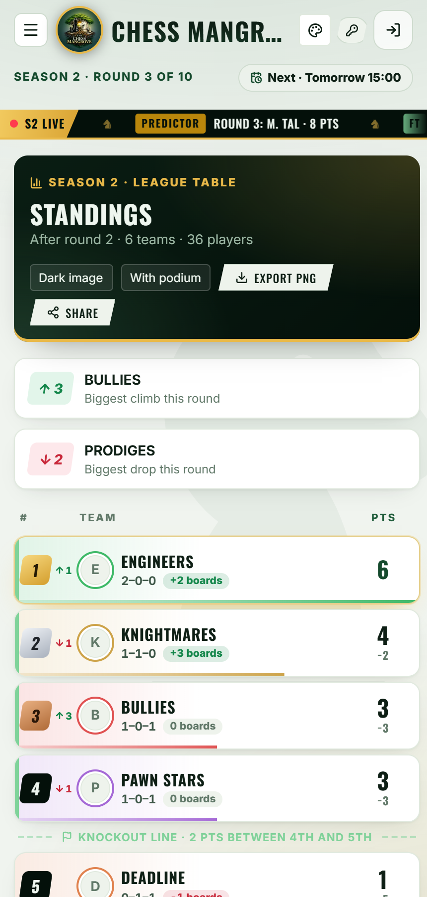 Standings</td>
<td align="center">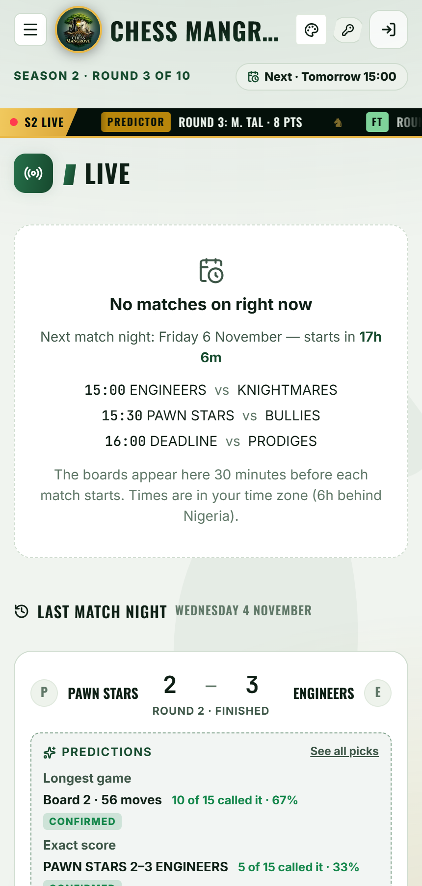 Live match night</td>
</tr>
<tr>
<td align="center">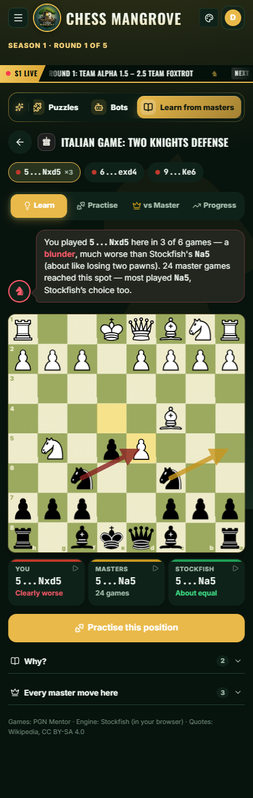 Learn from masters</td>
<td align="center">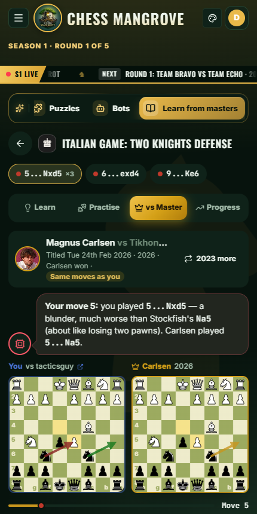 Your game vs a master's</td>
<td align="center">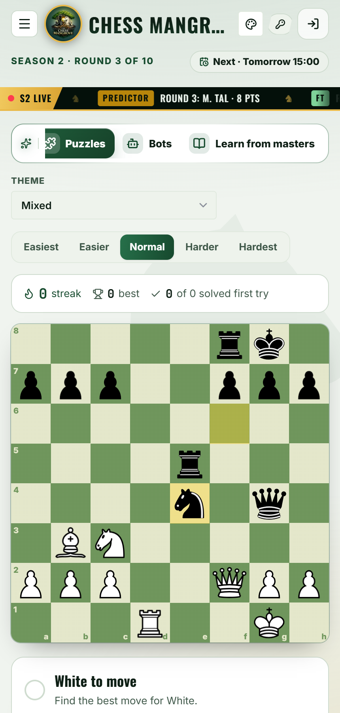 Puzzles</td>
</tr>
<tr>
<td align="center">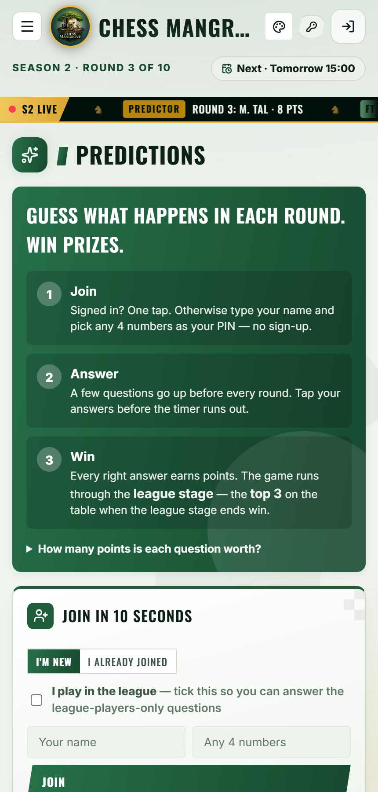 Predictions</td>
<td align="center">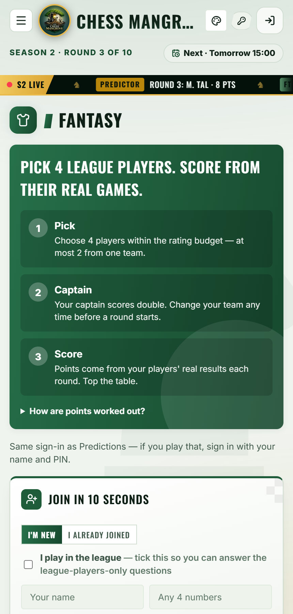 Fantasy</td>
<td align="center">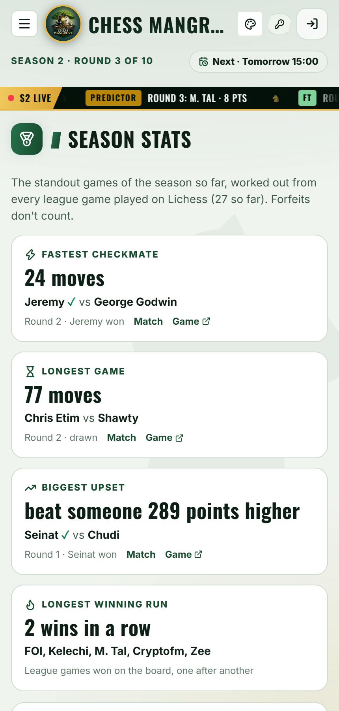 Season stats</td>
</tr>
</table>

Desktop views

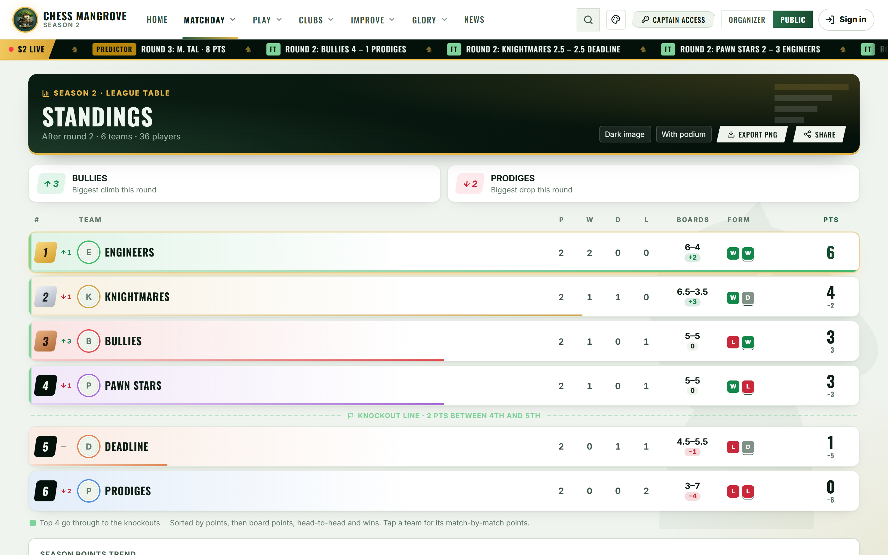
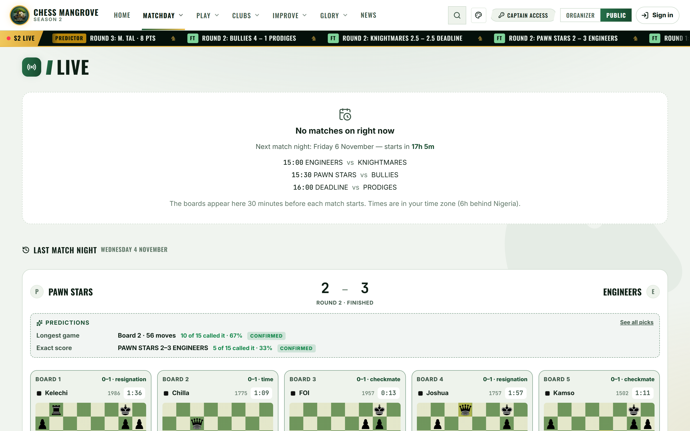
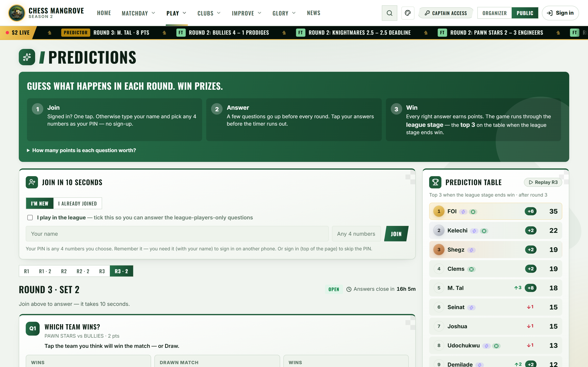
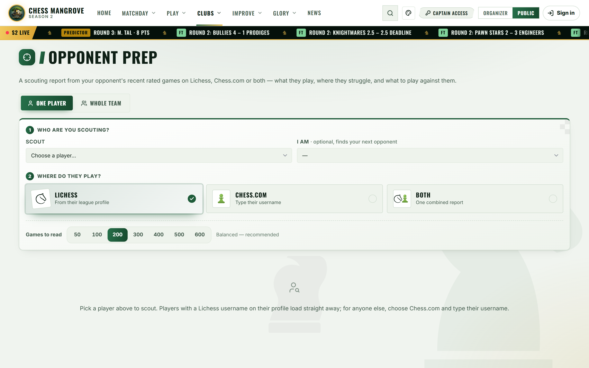

## Built with

| | |
|---|---|
| **App** | React 19, TypeScript, Vite, Framer Motion |
| **Data and sign-in** | Firebase Realtime Database and Authentication; Lichess OAuth |
| **Chess** | chess.js, Stockfish (WebAssembly, runs in the browser), the Lichess API |
| **Hosting** | Vercel; the masters database is served as small static files from GitHub Pages |

Game data comes from Lichess (CC0), [PGN Mentor](https://www.pgnmentor.com/) and the [Lichess Elite Database](https://database.nikonoel.fr/).

---

The source code is private. This page is a showcase of the project.

